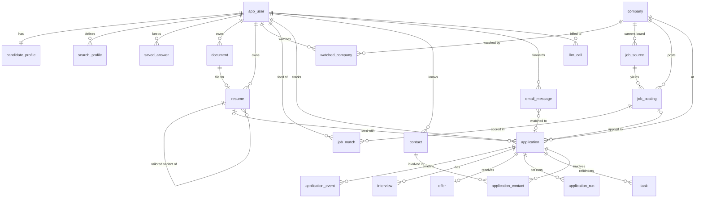
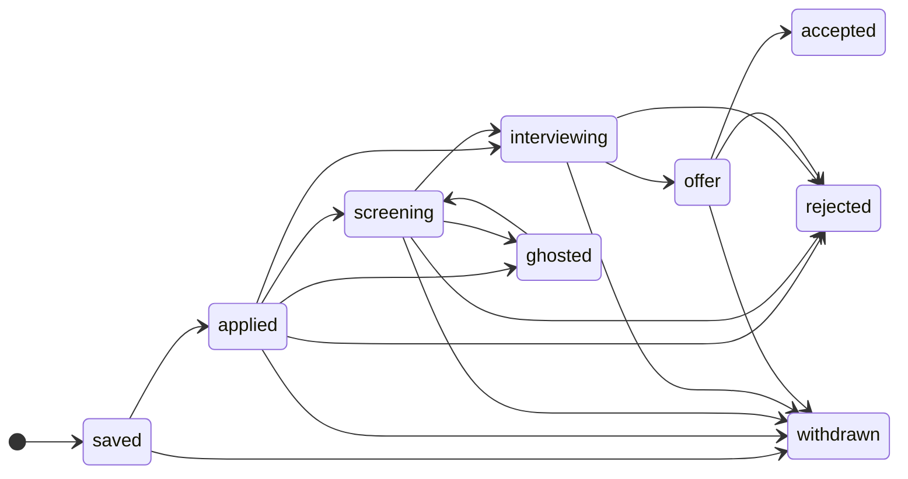
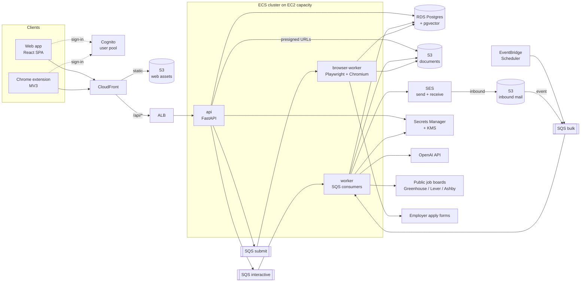
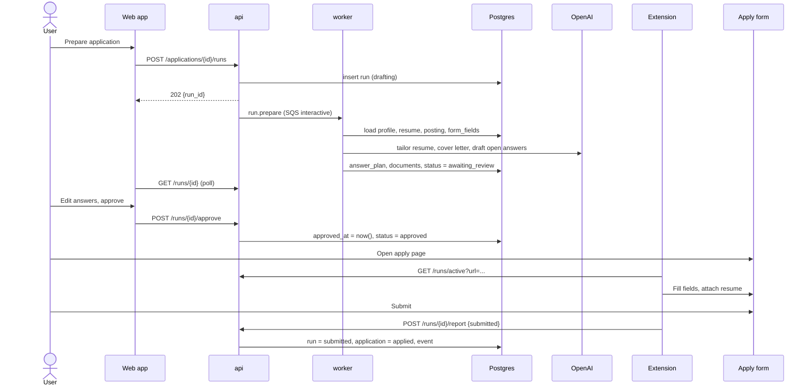

# Ise: architecture (draft)

Ise is a job tracker and job application bot. It finds postings that fit the user, scores them,
prepares tailored applications, fills application forms for the user, and tracks every
application from "saved" to "offer".

This repo (`ise-bff`) is the backend-for-frontend: the only API that the web app (`../ise-ui`) and
the browser extension call. This document covers the data model, the AWS and OpenAI architecture
for the backend and frontend, and the open questions.

**Status:** draft for review. Nothing here is built yet. The current `app/` code is the FastAPI
skeleton; its `bookings` router is a placeholder that will be replaced.

---

## 1. Scope

### v1

1. **Profile.** The user uploads a master resume, which is parsed into structured data. They fill in
   a profile (work authorisation, salary floor, links) and an answer bank of reusable answers to
   common application questions.
2. **Job capture.** Jobs come in three ways: the user clips the page they are on with the browser
   extension, the user pastes a URL, or the user watches a company and the backend polls that
   company's public job board (Greenhouse, Lever, Ashby).
3. **Matching feed.** New postings are pre-filtered by vector similarity and hard filters, then
   scored by an LLM. Each score comes with a short rationale (strengths, gaps, dealbreakers).
4. **Tracker.** A kanban board by status, plus a timeline per application with interviews,
   contacts, reminders and offers.
5. **Prepare an application.** On request, the backend writes a tailored resume and a cover letter
   and drafts an *answer plan* for the form's questions. The user reviews and approves it.
6. **Submit.**
   - **Extension autofill** (default): the extension fills the form in the user's own browser and
     the user clicks Submit.
   - **Server submit** (behind a feature flag): a headless browser submits the form, for ATSs with
     public, login-free forms (Greenhouse, Lever, Ashby).
7. **Email status updates.** The user forwards job emails to a personal inbound address. Each email
   is classified (rejection, interview request, and so on) and matched to its application, and the
   status change is suggested to the user.

### Later

- Direct Gmail/Outlook sync (instead of forwarding) and calendar sync for interviews.
- Interview prep (company brief, likely questions, mock interview).
- Analytics such as response rate by resume variant, by channel and by time to apply.
- Push notifications and a mobile layout pass.
- Billing and plans.

### Guardrails for the bot (v1, non-negotiable)

- **Human approval before every submission.** The database enforces this (see §2.6).
- **Never invent facts.** Work authorisation, sponsorship, salary, EEO/self-ID and dates come only
  from the profile or the answer bank, never from the LLM. Tailored resumes may reword and reorder
  the user's experience. A deterministic check rejects any employer, title, date or degree that is
  not in the master resume.
- **No CAPTCHA solving and no bypassing of bot detection.** The run stops with `needs_input` and
  hands control back to the user.
- **No automation of sites whose terms forbid it** (LinkedIn, Indeed and similar). The extension
  may *read* a page the user is viewing in order to clip a job. It does not apply or crawl there.
- **Rate limits** per user per day and per ATS domain.

---

## 2. Data model

### 2.1 Choices

- **PostgreSQL (RDS) with `pgvector`.** The tracker is relational: applications join postings,
  companies, resumes, events and contacts. The invariants below are partial unique indexes and
  checks, and similarity search sits in the same database. DynamoDB would need all of this
  rebuilt in application code.
- **IDs:** UUIDv7, generated in the app (`uuid.uuid7()`, Python 3.14+). They sort by time, so
  they index well and paginate by id.
- **Enumerations:** `text` with `CHECK` constraints instead of Postgres enums. Adding or removing a
  value is then a one-line constraint swap in a migration.
- **Timestamps:** always `timestamptz`. The user's IANA timezone lives on `app_user` and is
  applied when reminders are scheduled and times are shown.
- **Global vs per-user data.** `company`, `job_source` and `job_posting` are shared across users.
  A posting is extracted and embedded **once**, however many users see it. Every other table
  belongs to one user and carries `user_id`.
- **Tenant safety.** Child rows reference their parent by `(user_id, id)` through composite
  foreign keys, so a row can never point at another user's resume or application. Repository
  functions take `user_id` as their first argument. Postgres row-level security can be added
  later as defence in depth.
- **Embeddings:** `vector(1536)` (OpenAI `text-embedding-3-small`). If the embedding model
  changes, every vector is re-embedded; vectors from different models are never mixed.

### 2.2 Entity relationships



### 2.3 Tables at a glance

| Area | Table | Scope | Purpose |
|---|---|---|---|
| Identity | `app_user` | user | Account, timezone, plan, LLM budget, inbound email token |
| | `candidate_profile` | user | Facts used to fill forms: contact details, location, work authorisation, salary floor |
| | `search_profile` | user | What the user is looking for; drives matching |
| | `saved_answer` | user | Answer bank of reusable answers to application questions |
| | `watched_company` | user | Companies whose boards are polled for this user |
| Documents | `document` | user | Every file in S3: uploads, generated PDFs, screenshots |
| | `resume` | user | Master resume and tailored variants, parsed to structured JSON |
| Jobs | `company` | global | Deduplicated employers |
| | `job_source` | global | A board to poll (Greenhouse token, Lever site…) or an intake channel |
| | `job_posting` | global | A posting with its LLM-extracted requirements and its embedding |
| | `job_match` | user | A posting scored for one user: the feed |
| Tracker | `application` | user | One job the user is pursuing; holds the pipeline status |
| | `application_event` | user | Append-only timeline: status changes, notes, emails, bot activity |
| | `interview` | user | Interview rounds |
| | `contact`, `application_contact` | user | Recruiters, hiring managers, referrers |
| | `offer` | user | Offer terms and deadline |
| | `task` | user | Follow-ups and reminders |
| Bot | `application_run` | user | One attempt to fill and submit a form: answer plan, approval, result |
| Email | `email_message` | user | A forwarded email, its classification and the application it matched |
| Ops | `llm_call` | user / global | Every OpenAI call: purpose, model, tokens, cost |

### 2.4 Schema sketch

This is a sketch for review, not the migration. Alembic migrations will be generated from the
SQLAlchemy models in each module's `tables.py`.

#### Identity and profile

```sql
create extension if not exists citext;
create extension if not exists vector;

create table app_user (
  id                     uuid primary key,
  cognito_sub            text not null unique,
  email                  citext not null unique,
  full_name              text not null,
  timezone               text not null default 'UTC',          -- IANA name, e.g. 'America/Toronto'
  plan                   text not null default 'free' check (plan in ('free', 'pro')),
  monthly_llm_budget_usd numeric(8,2) not null default 5.00,   -- hard cap checked against llm_call
  inbound_email_token    text not null unique,                 -- u-<token>@in.<domain> forwarding address
  created_at             timestamptz not null default now(),
  updated_at             timestamptz not null default now()
);

create table candidate_profile (
  user_id                 uuid primary key references app_user on delete cascade,
  headline                text,
  phone                   text,
  city                    text,
  region                  text,
  country                 char(2),                              -- ISO 3166-1 alpha-2
  links                   jsonb not null default '{}',          -- {"linkedin": "...", "github": "...", "portfolio": "..."}
  work_authorization      jsonb not null default '{}',          -- {"US": "citizen", "CA": "requires_sponsorship"}
  willing_to_relocate     boolean not null default false,
  desired_salary_min      integer,
  desired_salary_currency char(3),
  notice_period_days      integer,
  updated_at              timestamptz not null default now()
);

create table search_profile (
  id                   uuid primary key,
  user_id              uuid not null references app_user on delete cascade,
  name                 text not null,                           -- "Senior backend, remote US"
  titles               text[] not null default '{}',
  keywords             text[] not null default '{}',
  excluded_keywords    text[] not null default '{}',
  excluded_company_ids uuid[] not null default '{}',
  locations            text[] not null default '{}',
  remote_types         text[] not null default '{remote,hybrid,onsite}',
  seniorities          text[] not null default '{}',
  min_salary           integer,
  salary_currency      char(3),
  is_active            boolean not null default true,
  query_embedding      vector(1536),                            -- profile text + master resume summary
  created_at           timestamptz not null default now(),
  unique (user_id, name),
  unique (user_id, id)
);

create table saved_answer (
  id                 uuid primary key,
  user_id            uuid not null references app_user on delete cascade,
  category           text not null check (category in ('work_authorization', 'sponsorship', 'salary',
                       'relocation', 'start_date', 'motivation', 'experience', 'eeo', 'other')),
  question           text not null,
  answer             text,
  answer_encrypted   bytea,                                     -- KMS envelope encryption; required for EEO
  question_embedding vector(1536),                              -- finds the saved answer for a new wording
  last_used_at       timestamptz,
  created_at         timestamptz not null default now(),
  check ((answer is null) <> (answer_encrypted is null)),
  check (category <> 'eeo' or answer_encrypted is not null)
);
```

#### Documents and resumes

```sql
create table llm_call (
  id                  uuid primary key,
  user_id             uuid references app_user on delete set null, -- null for shared work (posting extraction)
  purpose             text not null check (purpose in ('parse_resume', 'extract_job', 'embed', 'score_match',
                        'tailor_resume', 'cover_letter', 'answer_question', 'classify_email')),
  model               text not null,
  prompt_version      text not null,                            -- 'extract_job@3'; bump when the prompt changes
  openai_request_id   text,
  batch_id            text,                                     -- set when run through the Batch API
  input_tokens        integer not null default 0,
  cached_input_tokens integer not null default 0,
  output_tokens       integer not null default 0,
  cost_usd            numeric(10,6) not null default 0,
  latency_ms          integer,
  status              text not null check (status in ('ok', 'error', 'refused', 'invalid_output')),
  created_at          timestamptz not null default now()
);
create index llm_call_user_month on llm_call (user_id, created_at);

create table document (
  id           uuid primary key,
  user_id      uuid not null references app_user on delete cascade,
  kind         text not null check (kind in ('resume', 'cover_letter', 'screenshot', 'attachment')),
  origin       text not null check (origin in ('upload', 'generated', 'captured')),
  s3_key       text not null unique,                            -- users/{user_id}/documents/{id}.{ext}
  filename     text not null,
  content_type text not null,
  size_bytes   bigint not null,
  sha256       char(64) not null,
  llm_call_id  uuid references llm_call,                        -- set when origin = 'generated'
  created_at   timestamptz not null default now(),
  unique (user_id, id)
);

create table resume (
  id                  uuid primary key,
  user_id             uuid not null references app_user on delete cascade,
  name                text not null,                            -- "Backend 2026", "Acme – tailored"
  is_master           boolean not null default false,
  parent_resume_id    uuid,                                     -- set on a tailored variant
  tailored_for_job_id uuid,                                     -- references job_posting (defined below)
  document_id         uuid,                                     -- the PDF/DOCX; null until rendered
  parsed              jsonb,                                    -- JSON Resume shape; null until parsed
  plain_text          text,
  embedding           vector(1536),
  parsed_at           timestamptz,
  created_at          timestamptz not null default now(),
  unique (user_id, id),
  foreign key (user_id, document_id) references document (user_id, id),
  foreign key (user_id, parent_resume_id) references resume (user_id, id),
  check (not (is_master and parent_resume_id is not null))
);
create unique index one_master_resume_per_user on resume (user_id) where is_master;
```

#### Companies and jobs (global)

```sql
create table company (
  id              uuid primary key,
  name            text not null,
  normalized_name text not null,                                -- lowercased, legal suffixes stripped: 'acme'
  domain          citext unique,                                -- best dedupe key when known
  website_url     text,
  linkedin_url    text,
  industry        text,
  size_range      text,                                         -- '51-200'
  created_at      timestamptz not null default now()
);
create index company_normalized_name on company (normalized_name);

create table watched_company (
  user_id    uuid not null references app_user on delete cascade,
  company_id uuid not null references company on delete cascade,
  created_at timestamptz not null default now(),
  primary key (user_id, company_id)
);

-- One row per polled board, plus one row each for the 'manual', 'extension' and 'email' intake channels.
create table job_source (
  id             uuid primary key,
  kind           text not null check (kind in ('greenhouse', 'lever', 'ashby', 'smartrecruiters',
                   'workable', 'rss', 'manual', 'extension', 'email')),
  company_id     uuid references company,
  board_token    text,                                          -- 'acme' in boards-api.greenhouse.io/v1/boards/acme/jobs
  feed_url       text,
  is_active      boolean not null default true,
  poll_interval  interval not null default '6 hours',
  last_polled_at timestamptz,
  last_error     text,
  unique (kind, board_token)
);

create table job_posting (
  id                 uuid primary key,
  source_id          uuid not null references job_source,
  external_id        text,                                      -- ATS job id; null for clipped or pasted jobs
  company_id         uuid not null references company,
  title              text not null,
  normalized_title   text not null,
  seniority          text check (seniority in ('intern', 'junior', 'mid', 'senior', 'staff', 'principal',
                       'manager', 'director', 'executive')),
  employment_type    text check (employment_type in ('full_time', 'part_time', 'contract', 'internship', 'temporary')),
  remote_type        text check (remote_type in ('onsite', 'hybrid', 'remote')),
  location_text      text,                                      -- as posted
  countries          char(2)[] not null default '{}',
  salary_min         integer,
  salary_max         integer,
  salary_currency    char(3),
  salary_period      text check (salary_period in ('hour', 'year')),
  canonical_url      text not null,                             -- tracking params stripped
  apply_url          text,
  ats_kind           text,                                      -- picks the form adapter: 'greenhouse', 'workday', ...
  description_text   text not null,
  description_s3_key text,                                      -- raw HTML snapshot
  extracted          jsonb,                                     -- must_have, nice_to_have, years, sponsorship, ...
  extracted_at       timestamptz,
  content_hash       char(64) not null,                         -- sha256 of the normalised text; re-extract only on change
  embedding          vector(1536),
  posted_at          timestamptz,
  first_seen_at      timestamptz not null default now(),
  last_seen_at       timestamptz not null default now(),
  closed_at          timestamptz,                               -- set when it disappears from its board
  unique (source_id, external_id),
  unique (canonical_url)
);
create index job_posting_embedding on job_posting using hnsw (embedding vector_cosine_ops);
create index job_posting_open on job_posting (first_seen_at) where closed_at is null;

alter table resume add foreign key (tailored_for_job_id) references job_posting;

create table job_match (
  user_id           uuid not null references app_user on delete cascade,
  job_posting_id    uuid not null references job_posting on delete cascade,
  search_profile_id uuid,
  similarity        real not null,                              -- cosine similarity from the prefilter
  score             smallint check (score between 0 and 100),   -- LLM fit score; null until scored
  rationale         jsonb,                                      -- {"strengths": [], "gaps": [], "dealbreakers": []}
  state             text not null default 'new' check (state in ('new', 'seen', 'saved', 'dismissed', 'applied')),
  llm_call_id       uuid references llm_call,
  created_at        timestamptz not null default now(),
  primary key (user_id, job_posting_id),
  foreign key (user_id, search_profile_id) references search_profile (user_id, id) on delete set null (search_profile_id)
);
create index job_match_feed on job_match (user_id, state, score desc);
```

#### Tracker

```sql
create table application (
  id                       uuid primary key,
  user_id                  uuid not null references app_user on delete cascade,
  job_posting_id           uuid references job_posting,         -- null when tracked without a posting (referral, recruiter call)
  company_id               uuid not null references company,
  title                    text not null,                       -- snapshot; postings change or vanish
  status                   text not null default 'saved' check (status in ('saved', 'applied', 'screening',
                             'interviewing', 'offer', 'accepted', 'rejected', 'withdrawn', 'ghosted')),
  channel                  text not null default 'manual' check (channel in ('manual', 'extension', 'bot',
                             'referral', 'recruiter')),
  resume_id                uuid,
  cover_letter_document_id uuid,
  applied_at               timestamptz,
  last_activity_at         timestamptz not null default now(),
  next_action_at           timestamptz,                         -- drives the "needs follow-up" list
  priority                 smallint not null default 2 check (priority between 1 and 3),
  notes                    text,
  archived_at              timestamptz,
  created_at               timestamptz not null default now(),
  updated_at               timestamptz not null default now(),
  unique (user_id, id),
  foreign key (user_id, resume_id) references resume (user_id, id),
  foreign key (user_id, cover_letter_document_id) references document (user_id, id),
  check (status in ('saved', 'withdrawn') or applied_at is not null)
);
create unique index one_application_per_posting on application (user_id, job_posting_id)
  where job_posting_id is not null;
create index application_board on application (user_id, status, last_activity_at desc)
  where archived_at is null;

create table email_message (
  id                uuid primary key,
  user_id           uuid not null references app_user on delete cascade,
  message_id_header text not null,                              -- RFC 5322 Message-ID; dedupes re-forwards
  from_address      citext not null,
  subject           text not null,
  received_at       timestamptz not null,
  s3_key            text not null,                              -- raw MIME; the bucket expires it after 30 days
  classification    text check (classification in ('application_received', 'rejection', 'interview_request',
                      'assessment', 'offer', 'recruiter_outreach', 'other')),
  confidence        real,
  application_id    uuid,
  match_method      text check (match_method in ('sender_domain', 'thread', 'llm', 'user')),
  processed_at      timestamptz,
  unique (user_id, message_id_header),
  unique (user_id, id),
  foreign key (user_id, application_id) references application (user_id, id) on delete set null (application_id)
);

-- Append-only. Every status change writes one row in the same transaction as the update.
create table application_event (
  id               uuid primary key,
  user_id          uuid not null,
  application_id   uuid not null,
  kind             text not null check (kind in ('status_changed', 'note', 'email', 'interview',
                     'document', 'bot', 'follow_up')),
  from_status      text,
  to_status        text,
  actor            text not null check (actor in ('user', 'bot', 'email', 'system')),
  payload          jsonb not null default '{}',
  email_message_id uuid,
  occurred_at      timestamptz not null,
  created_at       timestamptz not null default now(),
  foreign key (user_id, application_id) references application (user_id, id) on delete cascade,
  foreign key (user_id, email_message_id) references email_message (user_id, id)
);
create index application_event_timeline on application_event (application_id, occurred_at);

create table interview (
  id             uuid primary key,
  user_id        uuid not null,
  application_id uuid not null,
  round          smallint not null,
  kind           text not null check (kind in ('recruiter_screen', 'phone', 'technical', 'take_home',
                   'onsite', 'behavioral', 'final', 'other')),
  starts_at      timestamptz,
  ends_at        timestamptz,
  location       text,                                          -- address or meeting URL
  outcome        text not null default 'pending' check (outcome in ('pending', 'passed', 'failed',
                   'cancelled', 'no_show')),
  prep_notes     text,
  feedback       text,
  created_at     timestamptz not null default now(),
  foreign key (user_id, application_id) references application (user_id, id) on delete cascade,
  check (ends_at is null or ends_at > starts_at)
);

create table contact (
  id           uuid primary key,
  user_id      uuid not null references app_user on delete cascade,
  company_id   uuid references company,
  full_name    text not null,
  title        text,
  email        citext,
  linkedin_url text,
  notes        text,
  created_at   timestamptz not null default now(),
  unique (user_id, id)
);

create table application_contact (
  user_id        uuid not null,
  application_id uuid not null,
  contact_id     uuid not null,
  role           text not null check (role in ('recruiter', 'hiring_manager', 'referrer', 'interviewer', 'other')),
  primary key (application_id, contact_id, role),
  foreign key (user_id, application_id) references application (user_id, id) on delete cascade,
  foreign key (user_id, contact_id) references contact (user_id, id) on delete cascade
);

create table offer (
  application_id uuid primary key references application on delete cascade,
  base_salary    integer,
  currency       char(3),
  bonus          text,
  equity         text,
  start_date     date,
  respond_by     date,
  status         text not null default 'open' check (status in ('open', 'negotiating', 'accepted', 'declined', 'expired')),
  notes          text
);

create table task (
  id             uuid primary key,
  user_id        uuid not null references app_user on delete cascade,
  application_id uuid,
  kind           text not null check (kind in ('follow_up', 'thank_you', 'prepare', 'deadline', 'custom')),
  title          text not null,
  due_at         timestamptz not null,
  notified_at    timestamptz,
  completed_at   timestamptz,
  created_by     text not null check (created_by in ('user', 'system')),
  created_at     timestamptz not null default now(),
  foreign key (user_id, application_id) references application (user_id, id) on delete cascade
);
create index task_due on task (due_at) where completed_at is null and notified_at is null;
```

#### Bot runs

```sql
create table application_run (
  id                       uuid primary key,
  user_id                  uuid not null,
  application_id           uuid not null,
  mode                     text not null check (mode in ('extension', 'server')),
  status                   text not null default 'drafting' check (status in ('drafting', 'awaiting_review',
                             'approved', 'running', 'needs_input', 'submitted', 'failed', 'cancelled')),
  ats_kind                 text not null,
  form_fields              jsonb,     -- discovered fields: [{key, label, type, required, options}]
  answer_plan              jsonb,     -- {key: {value, source: profile|saved_answer|llm|user, needs_review}}
  approved_at              timestamptz,
  started_at               timestamptz,
  finished_at              timestamptz,
  error_code               text,      -- captcha | login_required | field_unmapped | form_changed | timeout
  error_detail             text,
  confirmation_document_id uuid,      -- screenshot of the confirmation page
  created_at               timestamptz not null default now(),
  foreign key (user_id, application_id) references application (user_id, id) on delete cascade,
  foreign key (user_id, confirmation_document_id) references document (user_id, id),
  check (status not in ('running', 'submitted') or approved_at is not null)
);
create unique index one_active_run on application_run (application_id)
  where status in ('drafting', 'awaiting_review', 'approved', 'running', 'needs_input');
create unique index one_submission on application_run (application_id)
  where status = 'submitted';
```

### 2.5 Status machines

The service layer enforces the allowed transitions. Every transition writes an
`application_event` row in the same transaction.



`application_run`: `drafting → awaiting_review → approved → running → submitted`. From `running`, a
run can also go to `needs_input` (and back to `running` once the user resolves it) or to `failed`.
Any state before `submitted` can go to `cancelled`. A submitted run moves its application to
`applied`.

`ghosted` is never set automatically. A daily job *suggests* it for applications with no activity
for 30 days.

### 2.6 Rules the database enforces

Keep these in Postgres, not in application code:

| Rule | Mechanism |
|---|---|
| One application per user per posting | partial unique index `one_application_per_posting` |
| One bot run in flight per application | partial unique index `one_active_run` |
| A form is submitted at most once | partial unique index `one_submission` |
| No submission without user approval | `check (status not in ('running','submitted') or approved_at is not null)` |
| A row never references another user's data | composite FKs on `(user_id, id)` |
| One master resume per user | partial unique index `one_master_resume_per_user` |
| Postings are deduplicated | `unique (source_id, external_id)` and `unique (canonical_url)` |
| Re-forwarded emails are processed once | `unique (user_id, message_id_header)` |
| EEO answers are always encrypted | check on `saved_answer` |

### 2.7 Matching query

Stage 1 is SQL: hard filters plus nearest neighbours. Stage 2 sends only the survivors to the LLM.

```sql
set local hnsw.iterative_scan = relaxed_order;  -- keeps filtered ANN queries from returning short lists

select p.id, 1 - (p.embedding <=> :query_embedding) as similarity
from job_posting p
where p.closed_at is null
  and p.first_seen_at > now() - interval '30 days'
  and p.remote_type = any(:remote_types)
  and (p.salary_max is null or :min_salary is null or p.salary_max >= :min_salary)
  and p.company_id <> all(:excluded_company_ids)
  and not exists (select 1 from job_match m where m.user_id = :user_id and m.job_posting_id = p.id)
order by p.embedding <=> :query_embedding
limit 50;
```

The top 50 are inserted into `job_match` with `similarity`. The top 20 or so get an LLM `score` and
`rationale`.

### 2.8 Retention and deletion

- Account deletion is a hard delete. It cascades from `app_user`, and a worker deletes the
  `users/{user_id}/` prefix in S3.
- Raw inbound email is deleted after 30 days (S3 lifecycle rule). The classification and the
  subject line are kept.
- Confirmation screenshots are deleted after 180 days.
- Prompts and completions are not stored by default. `llm_call` holds only metadata.

---

## 3. System architecture (AWS + OpenAI)

### 3.1 Overview



### 3.2 Backend

**One container image, three ECS services.** Each service runs on EC2 capacity through a
capacity provider backed by an Auto Scaling group.

| Service | Command | Scaling | Notes |
|---|---|---|---|
| `api` | `uvicorn app.main:app` | 1–2 tasks behind the ALB | No OpenAI calls on the request path. Slow work is queued. |
| `worker` | `python -m app.workers` | 1–3 tasks, on queue depth | Polls `interactive` before `bulk`. Handles ingestion, enrichment, matching, generation and email. |
| `browser-worker` | `python -m app.browser` | 0–2 tasks, on `submit` depth | Separate image layer with Chromium. Has the most memory. Scales to zero when idle. |

**Why ECS on EC2.** The browser worker needs a real container with Chromium and a gigabyte or more
of memory per browser. LLM generation calls can take tens of seconds. Running everything on one
small cluster keeps one deployment model and one image. At launch, a single `t4g.medium` (arm64,
4 GB; the Playwright images are multi-arch) runs all three services. The ASG spans two AZs with a
minimum of 1.

*Alternative.* `api` and `worker` would also fit Lambda (API Gateway or a function URL, plus SQS
triggers), leaving ECS only for the browser worker. That is cheaper when idle, but it means two
deployment models. Revisit it if the always-on cost matters more than the simplicity.

**Queues.** Each queue has a dead-letter queue and a CloudWatch alarm on DLQ depth.

| Queue | Producer | Messages |
|---|---|---|
| `interactive` | api | `job.clip`, `resume.parse`, `run.prepare`, `resume.tailor`, `cover_letter.generate` (someone is waiting) |
| `bulk` | Scheduler, S3 events, worker | `source.poll`, `posting.enrich`, `match.user`, `mail.process`, `task.notify`, `sweep` |
| `submit` | api (on approval) | `run.submit` (server mode only) |

Messages carry IDs, not payloads: `{"type": "posting.enrich", "id": "…", "attempt": 1}`. Handlers
read the current state from Postgres and are idempotent. A `sweep` job every 10 minutes re-queues
anything stuck, such as a posting with no embedding after 10 minutes or a run left in `running`
past its timeout. With the sweep in place, no outbox table is needed.

**Schedules** (EventBridge Scheduler sending to SQS):

| Every | Message | Effect |
|---|---|---|
| 15 min | `source.poll` | Polls each active `job_source` whose `last_polled_at + poll_interval` has passed |
| 1 h | `match.user` (fan-out) | Matches new postings for every active `search_profile` |
| 5 min | `task.notify` | Emails reminders that are due (SES) |
| 10 min | `sweep` | Re-queues stuck work |
| daily | `postings.close`, `applications.ghost_suggest` | Closes postings no longer on their board; suggests `ghosted` |

**Data and storage**

- **RDS PostgreSQL 17+**: `db.t4g.micro`, single-AZ at launch, gp3, 7-day automated backups,
  encrypted, `pgvector` enabled. Move to Multi-AZ once there are paying users.
- **S3 `documents`**: SSE-KMS, all public access blocked, keys under `users/{user_id}/`. Uploads
  and downloads use presigned URLs, so the API never streams file bytes.
- **S3 `inbound-mail`**: written by an SES receipt rule, 30-day expiry. An S3 event sends a
  `mail.process` message to the `bulk` queue.
- **Secrets Manager**: the OpenAI API key, and the RDS master secret (managed by RDS).
- **KMS**: one customer-managed key, used for S3, RDS and app-level envelope encryption of
  `saved_answer.answer_encrypted`.

**Networking.** One VPC across two AZs. The ALB sits in public subnets. ECS instances and RDS sit
in private subnets. Outbound traffic to OpenAI, job boards and ATS forms goes through NAT: one NAT
gateway, or a `fck-nat` instance at about a tenth of the cost. A free S3 gateway endpoint keeps S3
traffic off the NAT. The ALB security group accepts traffic only from the CloudFront managed
prefix list.

**Auth (Cognito)**

- A user pool with managed login, email and password plus Google federation.
- **Web:** the BFF runs the authorisation-code flow (`/auth/login`, `/auth/callback`). It then sets
  the access token in a `__Host-` HttpOnly, Secure, SameSite=Lax cookie and the refresh token in a
  second HttpOnly cookie scoped to `/auth/refresh`. No token is visible to JavaScript. Mutating
  requests also require a custom header, as a CSRF check.
- **Extension:** `chrome.identity.launchWebAuthFlow` with PKCE, then an `Authorization: Bearer`
  header.
- The API's auth dependency accepts either form. It verifies the Cognito JWT against the cached
  JWKS and maps `sub` to `app_user`. This replaces the placeholder `verify_token` in
  `app/main.py`, which currently accepts any non-empty token.

**Ingestion adapters** (`app/modules/jobs/sources/`). Each adapter is one file implementing
`list_postings(source) -> Iterable[RawPosting]`:

- Greenhouse: `GET boards-api.greenhouse.io/v1/boards/{token}/jobs?content=true`. The
  per-job `?questions=true` call also returns the application questions, which gives form
  discovery for free.
- Lever: `GET api.lever.co/v0/postings/{site}?mode=json`.
- Ashby: `GET api.ashbyhq.com/posting-api/job-board/{name}`.
- Clip and paste: the extension sends the URL and the page text. The URL is canonicalised, and if
  it matches a known ATS, the structured API is used instead of the page text.

**Form adapters** (`app/browser/ats/`). There is one adapter per `ats_kind`, with a `discover()`
method (returns `form_fields`) and a `fill(page, plan)` method. The extension's content scripts
and the server's Playwright adapters share one field-mapping spec (`ats/<kind>.json`), so the two
submit paths don't drift apart. Workday and other ATSs that need a login are extension-only.

### 3.3 OpenAI

All OpenAI access goes through `app/llm/`. Business logic calls typed functions such as
`extract_job(text) -> JobExtraction` and never imports the SDK. Each function:

- Uses the **Responses API with Structured Outputs**. The JSON schema comes from a Pydantic model,
  and the output is validated again on return. An invalid result is retried once and then logged
  as `invalid_output`.
- Sets `store=False`, so OpenAI does not keep responses for later retrieval. (API data is not used
  for training by default.)
- Orders the prompt as stable instructions, then the resume, then the posting. This lets
  automatic prompt caching reuse the long shared prefix.
- Writes one `llm_call` row with tokens and cost. Before each call, the worker checks the user's
  month-to-date spend against `monthly_llm_budget_usd`. A global kill switch in SSM Parameter
  Store stops all calls.
- Reads model names from config (`OPENAI_MODEL_SMALL`, `OPENAI_MODEL_LARGE`,
  `OPENAI_EMBEDDING_MODEL`), never from code. Check the current model line-up and prices before
  launch.

| Task | Trigger | Model tier | Queue | Output |
|---|---|---|---|---|
| Parse resume | upload | large | interactive | `resume.parsed`, `plain_text`, `embedding` |
| Extract posting | new posting or changed `content_hash` | small | bulk (Batch API for backfills) | `job_posting.extracted`, seniority, salary, remote type |
| Embed | posting, resume, search profile, saved answer | embedding | bulk | `vector(1536)` columns |
| Score match | top ~20 after the SQL prefilter | small | bulk (Batch API for the nightly re-score) | `job_match.score`, `rationale` |
| Tailor resume | user action | large | interactive | new `resume` variant, rendered to PDF (WeasyPrint) |
| Cover letter | user action | large | interactive | `document` |
| Draft answers | `run.prepare` | small; large for essay questions | interactive | `application_run.answer_plan` |
| Classify email | inbound mail | small | bulk | `email_message.classification`, `application_id` |

**Answer drafting order** for each form field:

1. A deterministic mapping from the profile (name, email, phone, links, work authorisation).
2. The nearest `saved_answer` by `question_embedding`, used if similarity is above a threshold.
3. The LLM, with the profile, the resume and the posting as context. The answer is marked
   `needs_review: true`.

Factual categories (authorisation, sponsorship, salary, EEO) skip step 3. If they can't be filled
from steps 1 and 2, the field is left blank and flagged for the user. When the user edits an
answer during review, they can save it back to the answer bank.

**Evals.** `tests/evals/` keeps a small golden set: around 20 postings, 5 resumes and 30 emails with
expected outputs. CI runs it whenever a `prompt_version` or a model setting changes.

### 3.4 Frontend (`ise-ui`)

**Web app.** React and TypeScript on Vite, with React Router, TanStack Query for server state, and
Tailwind with shadcn/ui. It is a static SPA: the app is behind a login and needs no SEO, so there is
no server rendering to host.

| Screen | What it shows |
|---|---|
| Feed | `job_match` by score, with the rationale, quick save and dismiss |
| Job | Posting details, the fit breakdown, Save and "Prepare application" |
| Board | Kanban by `application.status`; dragging a card changes its status |
| Application | Timeline (`application_event`), interviews, contacts, documents, offer, tasks |
| Review run | Form fields and drafted answers side by side, with their sources and "needs review" flags; edit, approve, launch |
| Documents | Resumes and their variants, cover letters, upload |
| Profile | Candidate profile and the answer bank |
| Settings | Search profiles, watched companies, the forwarding address, notification preferences |
| Insights | Funnel and response rates (later) |

- The API client is generated from FastAPI's OpenAPI schema (`openapi-typescript`), so the UI and
  the BFF stay in sync. The extension uses the same client.
- Long-running actions (prepare, tailor) return `202` with an id. The UI polls
  `GET /runs/{id}` (or the generation endpoint) until the job is done. SSE can come later.
- **Hosting:** `vite build`, then sync to a private S3 bucket that CloudFront reads through Origin
  Access Control. The same distribution routes `/api/*` to the ALB, so everything is same-origin:
  no CORS, and the cookies just work. Deploys go through GitHub Actions with a CloudFront
  invalidation.

**Browser extension (Chrome MV3, TypeScript).** It lives in the `ise-ui` repo as a second app.

- **Popup:** "Save this job". It sends the URL and the page text to `POST /api/jobs/clip`.
- **Content scripts** for the supported ATS domains. They read the form (for `discover`), fetch
  the approved run for the current URL, fill the fields, attach the resume (downloaded through a
  presigned URL), and report the outcome to `POST /api/runs/{id}/report`. **The user clicks
  Submit.**
- **Permissions:** `activeTab`, `scripting`, `identity`, and host permissions only for the
  supported ATS domains and the Ise domain.
- Distributed as an unlisted Chrome Web Store listing at first.

### 3.5 Key flows

**Clip a job**

1. The extension calls `POST /jobs/clip` with the URL and the page text.
2. The API canonicalises the URL. If the posting already exists, it is returned. Otherwise the API
   inserts a `job_posting` from the `extension` source, creates an `application` with status
   `saved`, and queues `posting.enrich` on `interactive`.
3. The worker extracts the posting and stores its embedding, then scores it for this user right
   away.

**Prepare and submit**



In server mode, approval also queues `run.submit`. The browser worker loads the form, checks that
it still matches `form_fields` (and stops with `form_changed` if not), fills it, submits, saves a
screenshot of the confirmation page, and reports the outcome itself.

If the form isn't known in advance (any ATS without a discovery API), the extension sends the
fields it reads to `POST /runs/{id}/fields`. The run goes back to `drafting` for a few seconds
while the worker drafts the missing answers.

**Email status update**

1. The user creates a mail filter that forwards job emails to `u-<token>@in.<domain>`.
2. SES stores the email in S3, and an S3 event queues `mail.process`.
3. The worker resolves the token to a user and deduplicates on `Message-ID`. It matches the email
   to an application by sender domain, then by thread, then by LLM. It classifies the email.
4. It writes an `email_message` row and an `application_event`, and creates a suggested status
   change. Rejections and interview requests above a confidence threshold are applied
   automatically; everything else waits for the user to confirm.

This avoids Gmail's restricted `gmail.readonly` scope, which requires Google's verification and a
yearly third-party security assessment for a public app. Direct Gmail sync is a later feature.

### 3.6 API surface (v1)

```
GET    /me
GET    /auth/login              GET  /auth/callback      POST /auth/refresh     POST /auth/logout

GET    /profile                 PUT  /profile
GET    /answers                 POST /answers            PUT  /answers/{id}     DELETE /answers/{id}
GET    /search-profiles         POST /search-profiles    PUT  /search-profiles/{id}
GET    /watched-companies       POST /watched-companies  DELETE /watched-companies/{company_id}

POST   /documents/upload-url    (presigned PUT)          GET  /documents/{id}/download-url
GET    /resumes                 POST /resumes            POST /resumes/{id}/tailor {job_posting_id}

GET    /feed                    (job_match, paginated by score)
POST   /jobs/clip               GET  /jobs/{id}          POST /jobs/{id}/dismiss   POST /jobs/{id}/save

GET    /board                   (applications grouped by status, with counts)
POST   /applications            GET  /applications/{id}  PATCH /applications/{id}
POST   /applications/{id}/status
GET    /applications/{id}/events                         POST /applications/{id}/notes
POST   /applications/{id}/interviews                     PATCH /interviews/{id}
POST   /applications/{id}/contacts                       PUT  /applications/{id}/offer
GET    /tasks                   POST /tasks              PATCH /tasks/{id}

POST   /applications/{id}/runs  (prepare)                GET  /runs/{id}
POST   /runs/{id}/approve       POST /runs/{id}/cancel   POST /runs/{id}/fields
GET    /runs/active?url=        POST /runs/{id}/report

GET    /emails?unmatched=true   POST /emails/{id}/match  POST /emails/{id}/apply-suggestion
```

The routes are shaped for screens: `/board` and `/feed` return exactly what those screens render.
That is the point of a BFF.

### 3.7 Code layout

```
app/
  main.py                    # FastAPI app, router registration
  config.py                  # pydantic-settings; all env config
  auth/                      # Cognito JWT verification, cookie and bearer dependencies
  db/                        # engine, session, Alembic migrations
  adapters/                  # boto3 lives here only: queue.py (SQS), storage.py (S3), secrets.py, mail.py (SES)
  llm/                       # OpenAI client, prompts/, structured-output models, cost table
  modules/
    profiles/  documents/  jobs/  matching/  applications/  runs/  mail/  tasks/
      routes.py              # FastAPI router (thin)
      service.py             # business logic
      repository.py          # SQL; every function takes user_id first
      tables.py              # SQLAlchemy models
      schemas.py             # Pydantic request/response models
  workers/                   # SQS consumer loop and one handler per message type
  browser/                   # Playwright runner and ats/ adapters
tests/
  unit/  integration/  api/  evals/
```

Rules:

- `service.py` does not import FastAPI, boto3 or `openai`. It depends on `adapters/` and `llm/`
  through small Protocols, so the API, the workers and the tests share the same logic. Tests pass
  in fakes.
- Invariants live in Postgres (§2.6), not in services.
- Local development uses Docker Compose with `pgvector/pgvector` Postgres. The queue adapter has
  an in-process implementation, so no AWS account is needed to run the app locally.

Dependencies to add: `sqlalchemy`, `alembic`, `psycopg[binary]`, `pgvector`, `pydantic-settings`,
`openai`, `httpx`, `pyjwt[crypto]`, `playwright` (browser image only), `weasyprint` (worker).

### 3.8 Infrastructure, delivery and operations

- **IaC:** AWS CDK in Python, with four stacks: `network` (VPC, NAT, endpoints), `data` (RDS, S3,
  KMS, secrets), `app` (ECS cluster, ASG, services, ALB, SQS, Scheduler, SES) and `edge`
  (CloudFront, Cognito, ACM, Route 53).
- **CI/CD:** GitHub Actions with OIDC to AWS. Lint and test, build the arm64 image, push to ECR,
  run Alembic migrations as a one-off ECS task, then deploy the ECS services (rolling). For the UI:
  build, sync to S3, invalidate CloudFront.
- **Environments:** `dev` (local), `prod`. Add `staging` before inviting outside users.
- **Observability:**
  - Structured JSON logs to CloudWatch, with no resume text or prompts in them.
  - Alarms (to SNS email) on DLQ depth, 5xx rate, run failure rate by `ats_kind`, and daily
    LLM spend (summed from `llm_call`).

### 3.9 Launch cost floor (rough)

These are approximate on-demand prices for `us-east-1`. Check them in the AWS Pricing Calculator.

| Item | ~USD/month |
|---|---|
| EC2 `t4g.medium` ×1 (ECS) | 25 |
| RDS `db.t4g.micro` single-AZ + 20 GB gp3 | 15 |
| ALB (hours + low LCU) | 18 |
| NAT gateway (or `fck-nat` on `t4g.nano` ≈ 4) | 33 |
| Public IPv4 addresses (ALB, NAT) | 10 |
| CloudFront, S3, SQS, SES, Scheduler, KMS, Secrets Manager, CloudWatch | 10 |
| Cognito (within the free MAU allowance) | 0 |
| **AWS total** | **~110 (≈ 80 with fck-nat)** |
| OpenAI | usage-based; reported per user from `llm_call` and capped per user |

---

## 4. Decisions in this draft

These are the defaults this draft assumes. Change any of them before building.

1. Multi-user from day one, with `user_id` on every row. This is cheap now and painful to add
   later. It also works for a single-user tool.
2. PostgreSQL with pgvector as the only datastore.
3. ECS on EC2 for all compute: one image and three services.
4. Extension autofill is the default submit path. Server submit sits behind a flag and covers
   Greenhouse, Lever and Ashby only.
5. Email comes in by forwarding to an SES inbound address, not by Gmail or Outlook OAuth.
6. Static React SPA on S3 and CloudFront, same-origin with the API.
7. No LLM calls on the API request path. All of them go through SQS workers.

## 5. Still to confirm

- **Who is it for?** A personal tool or a product for other job seekers. This drives Cognito
  setup, the Chrome Web Store listing, billing, and how strict the per-user budgets need to be.
- **Server-side submission in v1, or extension only?**
- **Target markets.** This affects the work-authorisation fields, salary currencies, and the
  country filters on postings.
- **First job sources.** Greenhouse, Lever and Ashby are assumed. Should an aggregator API
  (for example Adzuna or USAJOBS) be added for broader discovery?
- **AWS region.** `us-east-1` is assumed. SES inbound receiving is only offered in some regions.
- **OpenAI budget per user per month.** `$5` is a placeholder.
- **Frontend stack preference.** This draft assumes React + Vite.
